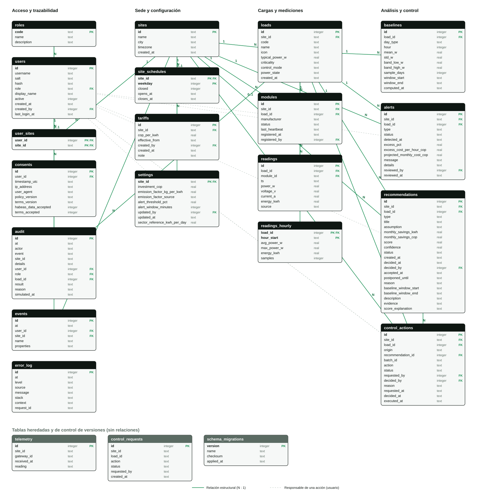
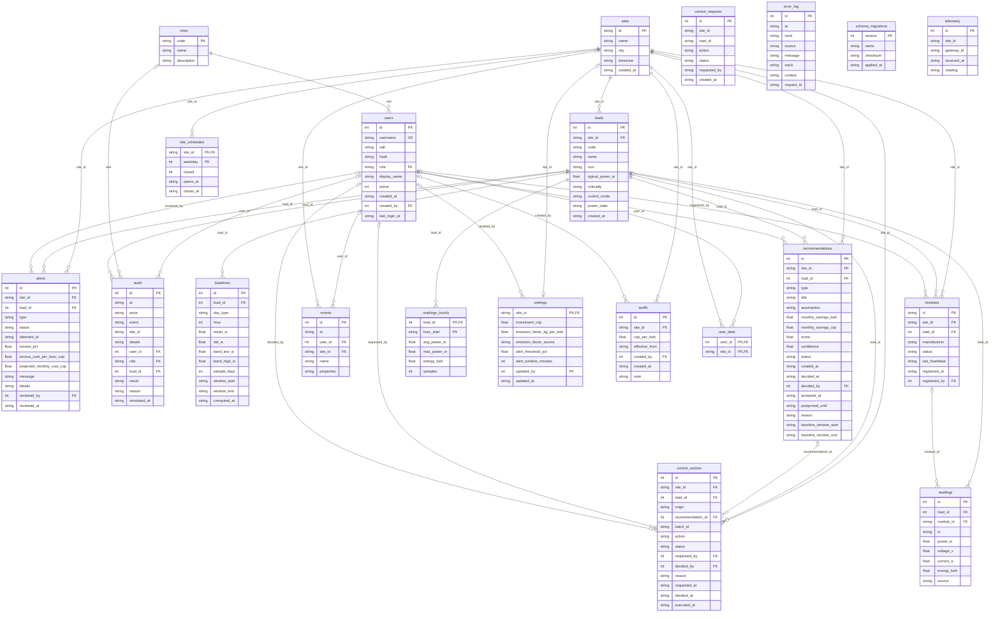

# Modelo de datos y diagrama entidad-relación (DER)

Base de datos SQLite (`node:sqlite`, Node 24) con esquema versionado en `backend/db/migrations/`. El diagrama se genera a partir del esquema real, por lo que no puede desactualizarse sin que se note.



Imagen rasterizada: [`der.png`](der.png). Vector: [`der.svg`](der.svg). Fuente Mermaid al final de este documento y en [`der.mmd`](der.mmd).

## Migraciones

| Migración | Contenido |
|---|---|
| `001_initial_schema.sql` | Las cuatro tablas del primer MVP (`users`, `telemetry`, `audit`, `control_requests`). Es idempotente para adoptar bases ya existentes sin perder datos. |
| `002_reference_data.sql` | Roles, sedes, horarios, usuarios con rol (la tabla se reconstruye), sedes por usuario, tarifas y configuración. |
| `003_loads_modules_readings.sql` | Cargas, módulos de medición, lecturas crudas y agregados por hora. |
| `004_analysis_and_control.sql` | Línea base, alertas, recomendaciones y acciones de control; extiende `audit` en el lugar. |
| `005_events_and_errors.sql` | Eventos de analítica y registro de errores. |
| `006_tariff_note.sql` | Columna `note` en `tariffs` (la tarifa de demostración se marca como ejemplo). |
| `007_legacy_telemetry_to_readings.sql` | Migra la tabla `telemetry` del primer MVP a sedes, cargas, módulos y lecturas. Omite las filas inválidas y conserva `telemetry` como archivo; la aplicación ya no escribe en ella. |

El ejecutor (`backend/db/migrate.js`) aplica cada archivo en orden dentro de una transacción, lo registra en `schema_migrations` con su checksum SHA-256 (normalizando saltos de línea) y es idempotente. Si un archivo ya aplicado fue modificado o eliminado, se niega a continuar: todo cambio de esquema debe ser una migración nueva. Tras cada migración se verifica `PRAGMA foreign_key_check`.

Las bases del MVP anterior se actualizan sin pérdida: el usuario `admin` con rol `Administrador` pasa al rol `owner`; cualquier otro rol heredado pasa al de menor privilegio (`non_technical_employee`).

## Entidades

Las fechas son texto ISO-8601 en UTC. Las enumeraciones se validan con restricciones `CHECK` o con clave foránea a una tabla de catálogo.

### Acceso y trazabilidad

| Tabla | Descripción |
|---|---|
| `roles` | Catálogo de los nueve roles: `owner`, `operations_manager`, `closing_employee`, `finance`, `sustainability`, `chain_owner`, `installer_technician`, `data_analyst`, `non_technical_employee`. |
| `users` | Usuario con contraseña derivada (scrypt: `salt`, `hash`), rol, estado activo y último ingreso. |
| `user_sites` | Sedes que cada usuario puede ver (un dueño de cadena tiene varias filas). |
| `audit` | Bitácora: usuario, rol, acción (`event`), carga, resultado (`executed`, `rejected`, `discarded`), motivo y hora simulada. Las filas heredadas conservan `event` y `details`. |
| `events` | Eventos de analítica de producto (nombre y propiedades JSON sin secretos). |
| `error_log` | Errores de la aplicación con nivel (`warn`, `error`, `fatal`), origen, traza y contexto. |

### Sede y configuración

| Tabla | Descripción |
|---|---|
| `sites` | Sede (identificador legible, por ejemplo `la-espiga-chia`), ciudad y zona horaria. |
| `site_schedules` | Horario de operación por día de la semana (0 = domingo). Un día cerrado no tiene horas. |
| `tariffs` | Historial de tarifas COP/kWh con fecha de vigencia; un cambio aplica desde su vigencia, nunca hacia atrás. |
| `settings` | Una fila por sede: inversión, factor de emisión y su fuente, umbral de alerta (30 % por defecto) y ventana (15 min por defecto). |

### Cargas y mediciones

| Tabla | Descripción |
|---|---|
| `loads` | Carga con criticidad (`critical`, `essential`, `non_essential`), modo de control (`monitor_only`, `control_enabled`) y estado de energía. Por defecto: `essential` y `monitor_only`. |
| `modules` | Módulo de medición: fabricante, carga asignada (como máximo un módulo por carga), estado (`active`, `inactive`, `error`), último latido y registro. |
| `readings` | Lecturas crudas de 1 minuto (potencia, voltaje, corriente, energía acumulada, origen). `(load_id, ts)` es único: reenvíos del buffer sin conexión y reimportaciones no duplican. |
| `readings_hourly` | Agregados por hora para el histórico antiguo (promedio, máximo, energía y muestras). |

### Análisis y control

| Tabla | Descripción |
|---|---|
| `baselines` | Perfil horario por carga y tipo de día (`workday`, `sunday`): media, desviación estándar y banda de incertidumbre (media ± 2 desviaciones), con la ventana de datos usada. |
| `alerts` | Alerta de tipo `consumption`, `off_hours`, `maintenance` o `inactive_module`, con estado `active` o `reviewed`, exceso, costo estimado por hora y proyectado al mes, y quién la revisó. |
| `recommendations` | Recomendación con tipo, supuesto, ahorro mensual (kWh y COP), puntaje, confianza y estado (`pending`, `accepted`, `postponed`, `discarded`), con decisión y motivo. |
| `control_actions` | Acción de control con origen (`manual`, `recommendation`, `closing_mode`, `autonomous`), acción (`on`, `off`), estado (`pending`, `approved`, `rejected`, `executed`, `discarded`), solicitante, quien decide y motivo. |

### Heredadas y control de versiones

| Tabla | Descripción |
|---|---|
| `telemetry` | Registro de ingestión del primer MVP (lectura como JSON). La ingestión actual de ESP32 sigue escribiendo aquí; las tareas de ingestión posteriores alimentarán `readings`. |
| `control_requests` | Solicitudes de apagado del primer MVP. Quedan hasta migrar el flujo a `control_actions`. |
| `schema_migrations` | Versión, nombre, checksum y fecha de cada migración aplicada. |

## Reglas que el esquema hace cumplir

- Una carga crítica nunca puede tener control habilitado (`CHECK` en `loads`).
- Como máximo una alerta activa por carga y tipo, y una recomendación pendiente por carga y tipo (índices únicos parciales).
- Una alerta revisada exige fecha de revisión; una recomendación aceptada exige fecha de aceptación; una acción ejecutada exige fecha de ejecución.
- Potencias, voltajes, corrientes y energía no pueden ser negativos; la confianza está entre 0 y 1; la tarifa es positiva.
- Un horario abierto exige hora de apertura menor que la de cierre.
- Claves foráneas activas (`PRAGMA foreign_keys = ON`): no hay registros huérfanos. Al borrar una sede se eliminan en cascada sus cargas, lecturas y análisis.

## Relaciones principales

- Una sede tiene muchas cargas, módulos, tarifas, alertas, recomendaciones y acciones de control, y exactamente una configuración.
- Una carga tiene muchas lecturas, agregados por hora, líneas base, alertas, recomendaciones y acciones de control; un módulo mide como máximo una carga.
- Una recomendación aceptada puede originar acciones de control.
- Un usuario pertenece a un rol y puede ver varias sedes; las relaciones de usuario con `created_by`, `reviewed_by`, `decided_by`, `requested_by`, `updated_by` y `registered_by` se dibujan punteadas porque solo registran quién hizo la acción.

## Regenerar el diagrama

```bash
node scripts/generate-der.js
```

Actualiza `der.svg`, `der.mmd` y el bloque Mermaid de este documento. Para rasterizar `der.png` sin red, con Edge o Chrome sin interfaz (ajuste ancho y alto al `width` y `height` del SVG):

```bash
msedge --headless --disable-gpu --hide-scrollbars --force-device-scale-factor=1 --window-size=1590,1569 --screenshot=docs/der.png file:///RUTA/docs/der.svg
```

## Fuente Mermaid

<!-- der:start -->

<!-- der:end -->
